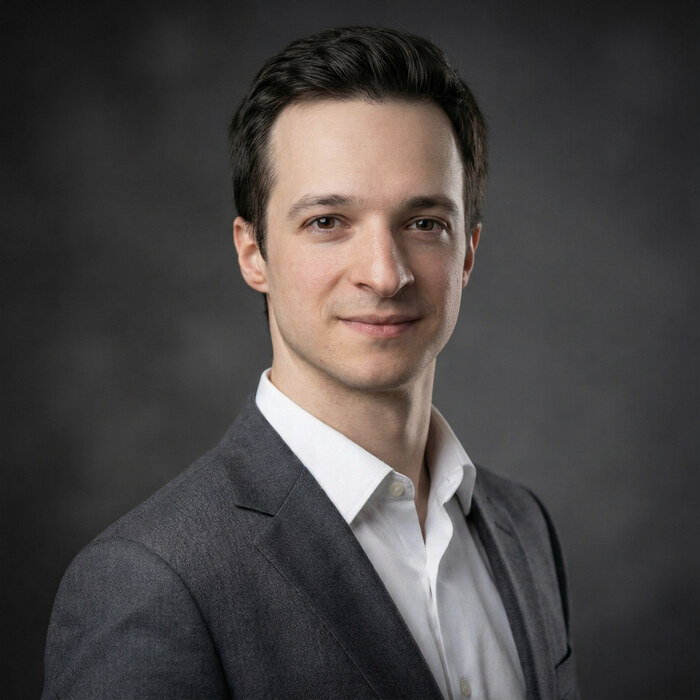

# About the course and about me {.unnumbered #sec-L00}

{width="180px" fig-align="left" fig-alt="Aleksandr Shemendyuk"}

I am Aleksandr Shemendyuk. I will teach you both the lectures and the seminars, in all three groups, so you will see me twice as often as you might like. Probability theory is in module 2, statistics and regression in module 3. You can write to me at aashemendyuk@mephi.ru. An HSE address may come later, and I will tell you.

## Where I come from

I did my bachelor at HSE, in the Faculty of Computer Science (Applied Mathematics and Informatics, 2013–2017), and my master at HSE too, in the Faculty of Economics (Statistical Modelling and Actuarial Science, 2017–2019). Then I went to HEC Lausanne, University of Lausanne (UNIL), Switzerland, for a PhD in Actuarial Science (2019–2024).

After the PhD I stayed at UNIL and taught master courses for the business analytics and management programmes: *Data Science in Business Analytics* (6 credits) and *AI Tools in Business Innovation* (3 credits), an elective I developed myself. The second one is about using AI for automation, customer support and AI apps: LLM APIs, make.com, n8n.io, and building a website with a backend and a database and connecting them.

Since September 2026 I am head of the *AI in Finance* lab at MEPhI (National Research Nuclear University) in Moscow. The lab is new and still growing, and projects appear fast. They run from the cost of institutional care to credit risk, and the common thread is how health connects to economics.

## What an actuary does

Insurers sell a promise: *if something bad happens, we pay.* Someone has to decide the price of that promise. An actuary prices it with probability. How often does a car crash? How large is a typical claim? How much money must be set aside so the company survives a terrible year?

That is the content of this course with the insurance removed: probability first, then statistics for estimating it from data.

## What I researched: care for the elderly

My data came from nursing homes in the canton of Geneva: more than 21,000 residents, followed from 1996 to 2018. An insurer or a nursing home has to answer three questions. How long will a resident stay? How much care will they need while they are there? What will it cost? All three are probability questions with real money behind them.

I wrote three papers on them with Joël Wagner (University of Lausanne).

- *Duration and intensity of care* (Annals of Actuarial Science, 2023, with M. Bladt and M. Fuino). An accelerated failure time model for how long people stay, and beta regression for how intensive the care is.
- *Health profiles* (Insurance: Mathematics and Economics, 2024). Spectral clustering finds eight typical profiles of residents, and multinomial logistic regression shows what decides the profile.
- *Costs over time* (Insurance: Mathematics and Economics, 2025). A multi-state Markov model: a resident moves between four care levels, from nearly independent to severely dependent, and each level has a price.

You will meet the same ideas here in simpler clothes. The Markov model is conditional probability, repeated: given that a resident is in state 2 today, what is the chance of state 3 tomorrow? That is Lecture 2. Length of stay is a random variable with a distribution, an expectation and a variance. That is Lectures 3 to 5. Regression and estimation from data come in module 3.

## Why this matters for a business student

Pricing, credit risk, inventory, quality control, A/B tests, surveys. All of them ask the same thing: how sure can we be, given what we know?

Take a bank that has just approved 1,000 loans. Some borrowers will not pay back, and nobody knows which ones.

In module 2 we work before any data. If each loan defaults with probability $p$, how many defaults should the bank plan for, and how far from that number can the real count be? In module 3 the bank has six months of real data. How well does it know $p$, and when is a change in the default rate more than bad luck?

## How we will work

Lectures run as two 80-minute blocks with a break. This book is the master copy of every lecture, and the slides retell it. Seminars use the same problem sheet in all groups, and the solutions appear in the book after the last group has done it.

Grading: to be confirmed. I will tell you in class.
