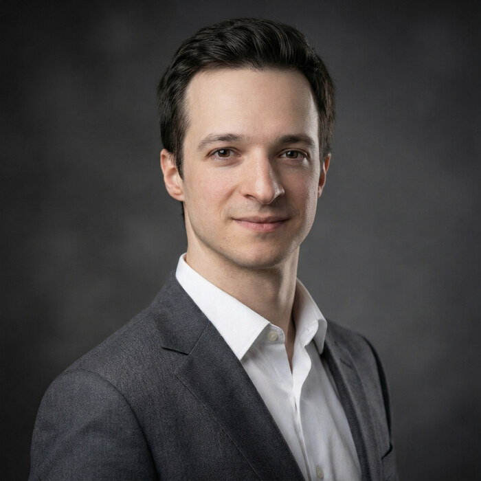



<!-- Intro deck for the first session. Not a lecture: no chapter, no tracker entry.
     Facts: degrees as given by Aleksandr; the paper is listed on Math-Net.ru (person192719).
     Everything in [TODO: …] is for Aleksandr to fill or delete before the session. -->

## Aleksandr Shemendyuk

:::: {.columns}
::: {.column width="55%"}
I will teach you both the lectures and the seminars, in all three groups.

. . .

So you will see me twice as often as you might like.

. . .

Probability theory in module 2. Statistics and regression in module 3.
:::
::: {.column width="45%"}
{width="330px" style="border-radius:8px"}

[TODO: e-mail and where to find me]{.muted}
:::
::::

## Where I studied

:::: {.columns}
::: {.column width="26%"}
{height="120px"}
:::
::: {.column width="74%"}
**Bachelor, HSE.** Computer Science, Applied Mathematics and Informatics. [TODO: years]
:::
::::

:::: {.columns}
::: {.column width="26%"}
{height="120px"}
:::
::: {.column width="74%"}
**Master, HSE, Faculty of Economics.** Statistical Modelling and Actuarial Science. [TODO: years]
:::
::::

:::: {.columns}
::: {.column width="26%"}
{width="280px"}
:::
::: {.column width="74%"}
**PhD in Actuarial Science.** HEC Lausanne, University of Lausanne (UNIL), Switzerland. [TODO: years]
:::
::::

. . .

Same university as you, then a few years in a different country.

## What I do now

:::: {.columns}
::: {.column width="38%"}
{width="420px"}
:::
::: {.column width="62%"}
Since September 2026 I am head of the **AI in Finance** lab at MEPhI (National Research Nuclear University), Moscow.

. . .

[TODO: two plain sentences on what the lab does and one project students could relate to.]{.muted}
:::
::::

## What an actuary does

Insurers sell a promise: *if something bad happens, we pay.* Someone has to decide the price of that promise.

. . .

An actuary prices it with probability. How often does a car crash? How large is a typical claim? How much money must be set aside so the company survives a terrible year?

. . .

That is the content of this course, with the insurance removed: probability first, then statistics for estimating it from data.

## What I research

My PhD was about **ruin**: the chance that an insurer's capital falls below zero.

. . .

A paper from that work, with G. Jasnovidov:

*Two-dimensional Parisian ruin problem and computation of corresponding Pickands constants.*
Theory of Probability and its Applications, 70(1), 2025, pp. 37–59.

. . .

"Parisian" means that being below zero for a moment is not yet ruin. The company has to stay below for a given length of time.

. . .

[TODO: one sentence on what the paper finds, in plain words, or cut this slide.]

## Why this matters for a business student

:::: {.columns}
::: {.column width="50%"}
Pricing, credit risk, inventory, quality control, A/B tests, surveys.

. . .

All of them are the same question: *how sure can we be, given what we know?*
:::
::: {.column width="50%"}
[TODO: one real example from your own practice or research that students would recognise.]{.muted}
:::
::::

## How we will work

- Lectures: two 80-minute blocks with a break. The book chapter is the master copy, the slides retell it.
- Seminars: the same problem sheet for all groups. Solutions appear in the book after the last group has done it.
- [TODO: grading, to be filled when the formula is fixed. See `admin/course-info.md`.]

## Questions

Ask me anything about the course, about studying in Lausanne, or about what an actuary does all day.

. . .

[TODO: contact details]{.muted}
